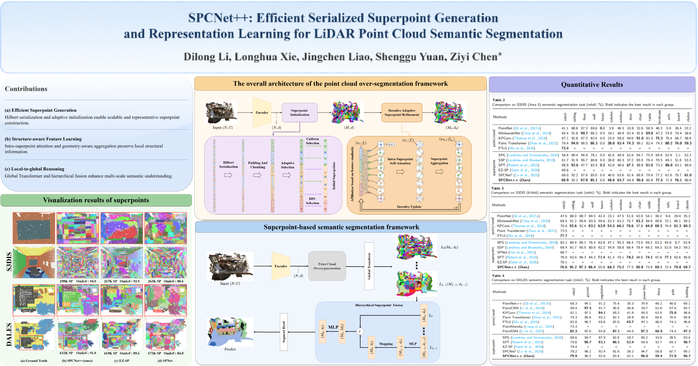

# SPCNet++: Superpoint‑based Network for Large‑Scale 3D Point Cloud Semantic Segmentation
<p align="center">

</p>

## Highlights

- **Serialized superpoint generation avoids costly spatial queries such as KNN and FPS.** 
- **Adaptive superpoint initialization balances both efficiency and quality.**
- **Intra-superpoint self-attention compensates the neglect of local context learning.**


## Results

### Indoor semantic segmentation

| Model | Benchmark | Num GPUs | Val mIoU |
|:-----:|:--------:|:--------:|:--------:|
| SPCNet++ | S3DIS (Area 5) | 2 | 69.9% |
| SPCNet++ | S3DIS (6-fold) | 2 | 76.6% |

### Outdoor semantic segmentation

| Model | Benchmark | Num GPUs | Val mIoU |
|:-----:|:--------:|:--------:|:--------:|
| SPCNet++ | DALES | 2 | 79.9% |


<!--
## Results

### Indoor semantic segmentation

| Model | Benchmark | Num GPUs | Val mIoU | Exp Record |
|:-----:|:--------:|:--------:|:--------:|:----------:|
| SPCNet++ | S3DIS (Area 5) | 2 | 69.9% | [link](exp/s3dis/s3dis-area5-SPCNet++/test.log) |
| SPCNet++ | S3DIS (6-fold) | 2 | 76.6% |  - |

### Outdoor semantic segmentation

| Model | Benchmark | Num GPUs | Val mIoU |  Exp Record |
|:-----:|:--------:|:--------:|:--------:|:----------:|
| SPCNet++ | DALES | 2 | 79.9% | [link](exp/dales/dales-SPCNet++/test.log) |
-->
## Environment

### Requirements

- Ubuntu: 18.04 and above.
- CUDA: 11.3 and above.
- PyTorch: 1.12.1.

### Conda Environment

```
bash
conda create -n SPCNet2 python=3.8 -y
conda activate SPCNet2
conda install ninja -y

# PyTorch 1.12.1 + CUDA 11.3
conda install pytorch==1.12.1 torchvision==0.13.1 torchaudio==0.12.1 cudatoolkit=11.3 -c pytorch -y

# Basic dependencies
conda install h5py pyyaml -c anaconda -y
conda install sharedarray tensorboard tensorboardx yapf addict einops scipy plyfile termcolor timm -c conda-forge -y
conda install pytorch-cluster pytorch-scatter pytorch-sparse -c pyg -y
pip install torch-geometric==2.5.2

# spconv (SparseUNet)
pip install spconv-cu113==2.3.6

# pointops
cd libs/pointops
python setup.py install
# docker & multi GPU arch
# TORCH_CUDA_ARCH_LIST="7.5 8.0" python setup.py install
cd ../..

# faiss (superpoint selection)
pip install faiss-gpu==1.7.2

# Open3D (visualization)
pip install open3d==0.18.0

# WandB (experiment logging)
pip install wandb==0.16.6

# Hydra config
pip install hydra-core==1.3.2 omegaconf==2.3.0

```
Alternatively, you can directly use the provided [`environment.yml`](./environment.yml):
```
bash
conda env create -f environment.yml
conda activate SPGNet
```

## Training and testing

```
bash
# Train on S3DIS
python scripts/train.sh -g 2 -d s3dis -c semseg-s3dis-SPCNet++ -n s3dis-area5-SPCNet++

# Test on S3DIS
python scripts/test.sh -g 2 -d s3dis -c semseg-s3dis-SPCNet++ -n s3dis-area5-SPCNet++

# Train on DALES
python scripts/train.sh -g 2 -d dales -c semseg-dales-SPCNet++ -n dales-SPCNet++

# Test on DALES
python scripts/test.sh -g 2 -d dales -c semseg-dales-SPCNet++ -n dales-SPCNet++

```

## Acknowledgements

We thank the authors of [Point Transformer V3](https://github.com/Pointcept/Pointcept). Our implementation is heavily built upon their codes.
